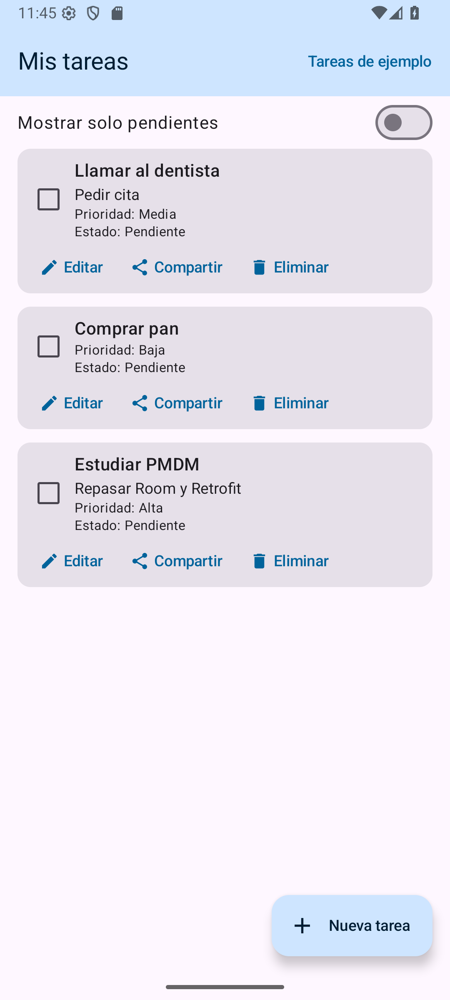
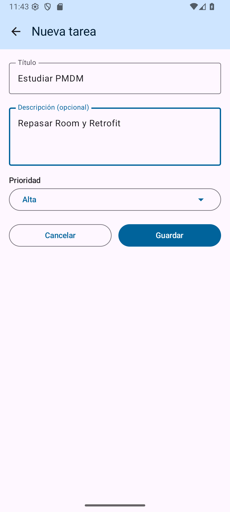
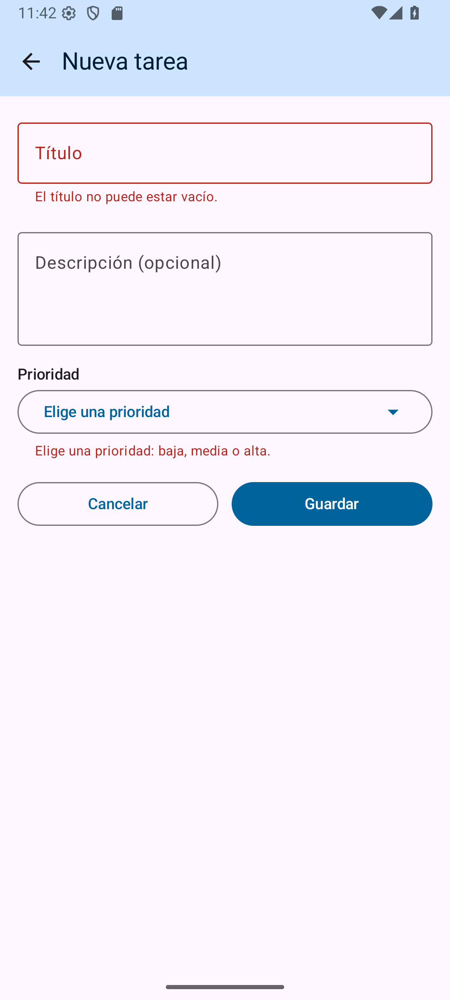
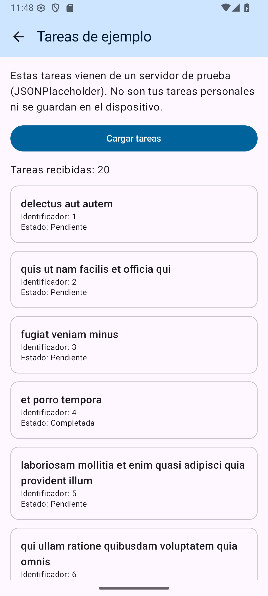
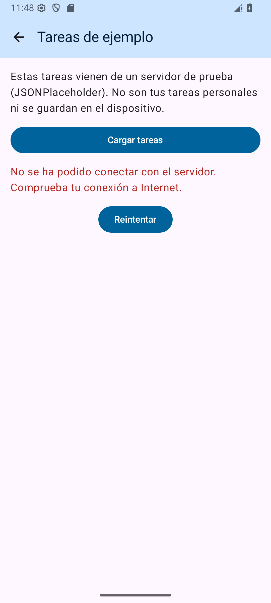
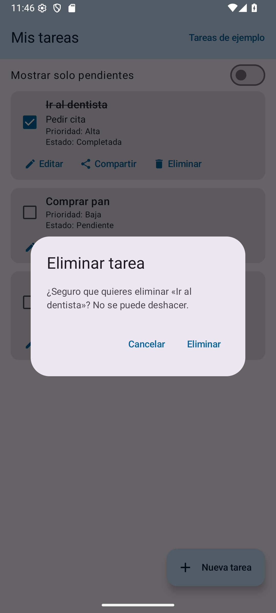
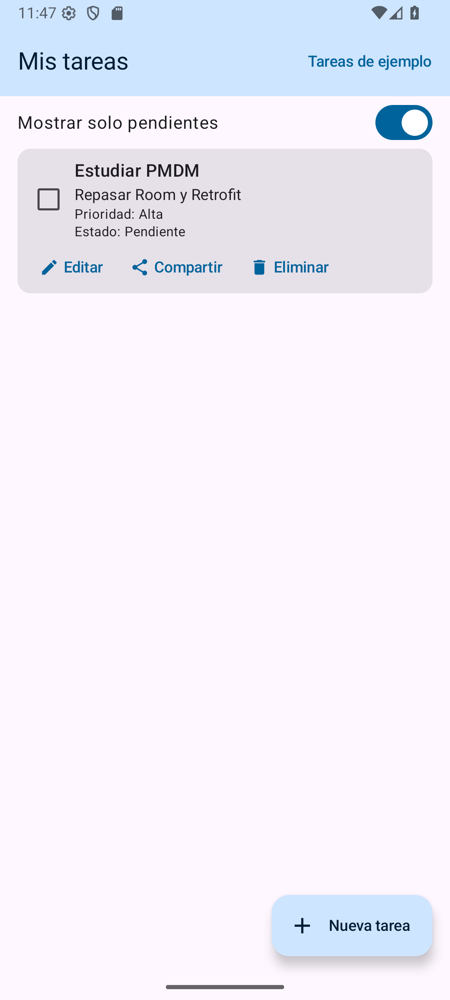
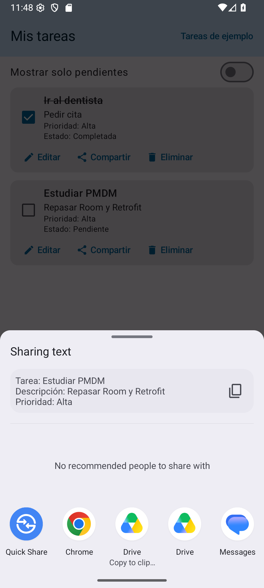
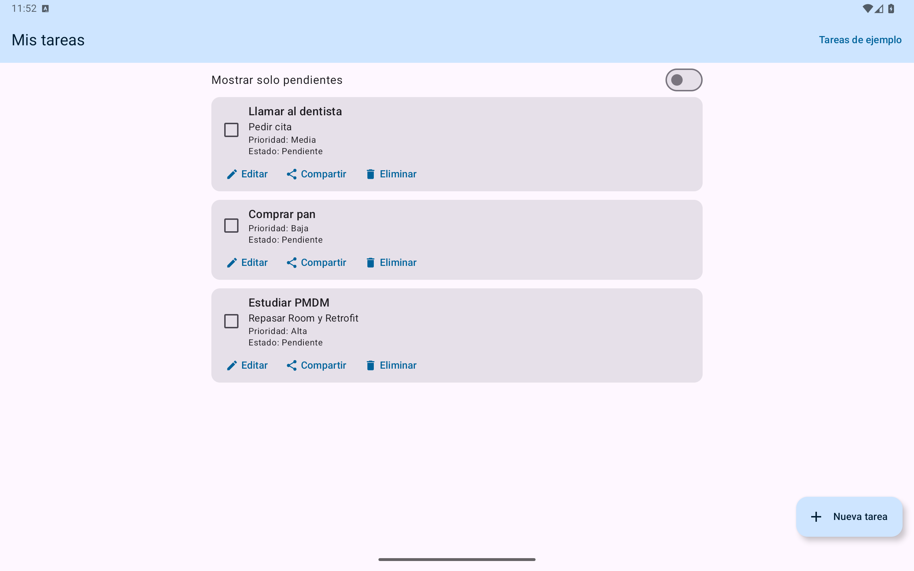
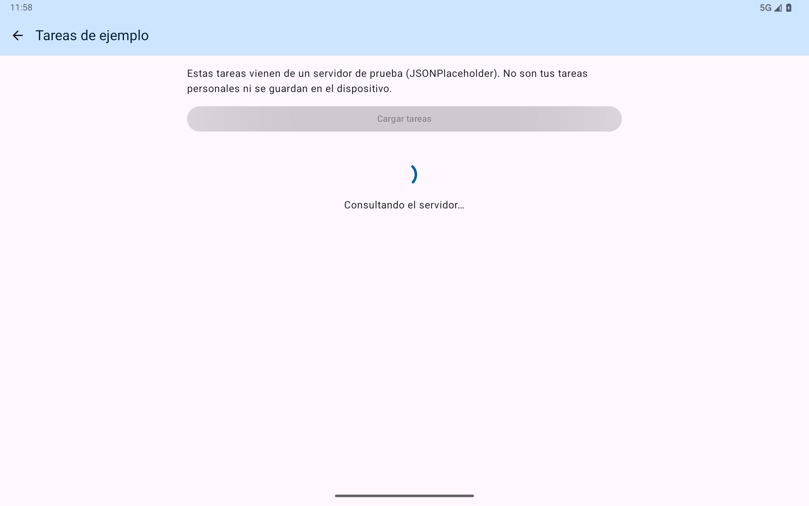

# Gestor Personal de Tareas

Aplicación Android para organizar tareas personales, académicas o profesionales. Permite crear tareas, consultarlas, modificarlas, marcarlas como completadas y eliminarlas. Las guarda en el dispositivo, permite compartirlas con otras aplicaciones y consulta tareas de ejemplo de un servicio web.

Práctica del módulo Programación Multimedia y Dispositivos Móviles (PMDM).

## Funcionalidades implementadas

- **Listado** de tareas en una `LazyColumn` con título, descripción, prioridad y estado, y un mensaje cuando no hay ninguna.
- **Creación** con validación: título obligatorio de al menos 3 caracteres (sin contar espacios exteriores), prioridad obligatoria y descripción opcional. Pulsar varias veces «Guardar» no crea duplicados.
- **Edición** de título, descripción y prioridad.
- **Completar** con un `Checkbox`.
- **Eliminación** con confirmación en un `AlertDialog`.
- **Almacenamiento permanente** con Room.
- **Filtro «Mostrar solo pendientes»** guardado con Preferences DataStore.
- **Tareas de ejemplo** de JSONPlaceholder (`GET /todos?userId=1`) con Retrofit: indicador de carga, botón deshabilitado durante la petición, mensajes de error y reintento.
- **Compartir** una tarea con `ACTION_SEND`, controlando que no haya aplicaciones compatibles.

## Organización del proyecto

Código en `app/src/main/java/com/example/gestortareas`:

| Paquete | Responsabilidad | Contenido |
|---|---|---|
| `modelo` | Modelo | `Tarea` (también es la entidad de Room), `Prioridad`, `ValidadorTarea` |
| `almacenamiento` | Almacenamiento | `TareaDao`, `AppDatabase` |
| `preferencias` | Preferencias | `PreferenciasTareas` (DataStore) |
| `comunicaciones` | Comunicaciones | `TareaEjemplo`, `TareasEjemploApi`, `ClienteRetrofit` |
| `interfaz` | Interfaz | `GestorTareasApp` (navegación), `TareasViewModel`, `TareasEjemploViewModel`, `Estados`, `CompartirTarea` |
| `interfaz/pantallas` | Interfaz | `PantallaListado`, `PantallaFormulario`, `PantallaTareasEjemplo` |
| `interfaz/componentes` | Interfaz | `TarjetaTarea`, `SelectorPrioridad`, `DialogoEliminar`, `ElementosComunes` |
| `interfaz/tema` | Interfaz | `Tema` |

Hay una sola actividad (`MainActivity`) y la navegación se hace con un estado. Los textos están en `res/values/strings.xml` y los iconos en `res/drawable`.

## Bibliotecas utilizadas

| Biblioteca | Versión | Uso |
|---|---|---|
| Jetpack Compose (BOM) y Material 3 | 2025.09.00 | Interfaz |
| Activity Compose | 1.11.0 | `setContent` y `BackHandler` |
| Lifecycle (ViewModel y runtime Compose) | 2.9.4 | Estado que sobrevive al giro |
| Room (con KSP 2.2.21-2.0.4) | 2.8.4 | Base de datos local |
| Preferences DataStore | 1.1.7 | Preferencia del filtro |
| Kotlin Coroutines | 1.10.2 | Operaciones asíncronas |
| Retrofit y converter-gson | 3.0.0 | Servicio web |
| OkHttp | 4.12.0 | Cliente HTTP con tiempos de espera |

## Entorno

- Android Studio Quail 4 (2026.1.4) con su JDK 25: el proyecto se abre y se sincroniza sin errores. También compila con JDK 17
- Kotlin 2.2.21, Gradle 9.1.0, Android Gradle Plugin 8.12.2
- `minSdk` 24, `targetSdk` 36, `compileSdk` 36

## Permisos

Solo `INTERNET`, para consultar el servicio web.

## Instrucciones para ejecutar la aplicación

**Desde Android Studio:** *File → Open*, elegir esta carpeta, esperar a que termine la sincronización de Gradle y pulsar *Run* con un emulador o dispositivo con Android 7.0 (API 24) o superior.

**Instalar el APK ya generado:**

```
adb install -r apk/GestorPersonalDeTareas-debug.apk
```

**Generar el APK de nuevo:**

```
gradlew assembleDebug
```

Se crea en `app/build/outputs/apk/debug/app-debug.apk`.

## Emuladores utilizados

| | Emulador 1 | Emulador 2 |
|---|---|---|
| Nombre | Medium Phone API 36.0 | Tablet Practica API 36 |
| Tipo | Teléfono, pantalla compacta | Tableta, pantalla grande |
| Resolución | 1080 × 2400 | 2560 × 1600 |
| Densidad | 420 dpi | 320 dpi |
| Orientación inicial | Vertical | Horizontal |
| Sistema | Android 16 (API 36), Google Play, x86_64 | Android 16 (API 36), Google Play, x86_64 |

Además se han pasado las 12 pruebas en otros cuatro emuladores con un teléfono Pixel (1080 × 1920, 420 dpi, x86_64): Android 7.0 (API 24), Android 8.0 (API 26), Android 11 (API 30) y Android 13 (API 33).

## Pruebas realizadas

Se han ejecutado con un script que maneja los emuladores mediante `adb`: pulsa y escribe en la pantalla, lee los textos que se ven y consulta directamente la base de datos de Room.

| Nº | Prueba | Resultado esperado | Resultado obtenido | Teléfono | Tableta |
|---|---|---|---|---|---|
| 1 | Crear una tarea válida | Se guarda y aparece en la lista | Aparece en la lista y en la base de datos | Correcto | Correcto |
| 2 | Guardar un título vacío | Se muestra un error y no se crea | Error junto al campo con título vacío, con solo espacios y con 2 letras; no se crea nada | Correcto | Correcto |
| 3 | Editar una tarea | Los cambios se muestran | Salen los datos actuales y, al guardar, los nuevos | Correcto | Correcto |
| 4 | Marcar como completada | Su estado cambia y queda guardado | Sigue completada tras cerrar y abrir la aplicación | Correcto | Correcto |
| 5 | Cancelar una eliminación | La tarea no desaparece | La base de datos no cambia | Correcto | Correcto |
| 6 | Eliminar confirmando | Desaparece de la base de datos | Ya no está en la lista ni en la base de datos | Correcto | Correcto |
| 7 | Cerrar y volver a abrir | Se recuperan las tareas | Se recuperan | Correcto | Correcto |
| 8 | Activar el filtro y reiniciar | Se conserva la preferencia | El filtro sigue activado | Correcto | Correcto |
| 9 | Consultar la API con Internet | Se muestran las tareas | Se muestran 20 tareas | Correcto | Correcto |
| 10 | Consultar la API sin conexión | Error y reintento | Sale el error y el reintento funciona al recuperar la red | Correcto | Correcto |
| 11 | Compartir una tarea | Se abre el selector | Se abre con título, descripción y prioridad | Correcto | Correcto |
| 12 | Cambiar la orientación | Sigue funcionando y conserva los datos | Se conservan las tareas, la consulta y el texto a medio escribir | Correcto | Correcto |

Comprobaciones adicionales:

| Comprobación | Resultado |
|---|---|
| Pulsar «Guardar» 4 veces seguidas | Se crea una sola tarea (los dos emuladores) |
| Mensaje de lista vacía y mensaje de «sin pendientes» | Correcto (los dos emuladores) |
| Indicador de carga y botón deshabilitado con la red ralentizada | Correcto (teléfono, tableta y los otros cuatro emuladores) |
| Letra del sistema al 200 % | Los botones siguen disponibles y el título de la barra no se corta (en todos los emuladores) |
| Girar con el diálogo de eliminar o con errores del formulario a la vista | Se conservan (en todos los emuladores) |
| Editar una tarea completada | Sigue completada (en todos los emuladores) |
| El sistema cierra la aplicación en segundo plano con el formulario a medias | Al volver sigue el texto escrito (en todos los emuladores) |
| Sin aplicaciones compatibles para compartir | Sale el aviso y la aplicación sigue funcionando (Android 8, 11 y 13, desactivando todas las aplicaciones que aceptan texto) |

## Capturas de pantalla

| Listado principal | Formulario de creación | Validación |
|---|---|---|
|  |  |  |

| Consulta a la API | Error sin conexión | Confirmar eliminación |
|---|---|---|
|  |  |  |

| Filtro activado | Compartir |
|---|---|
|  |  |

Tableta:





## Enlace al chat de IA

PENDIENTE: pegar aquí el enlace

## Incidencias conocidas y límites

- Todas las funcionalidades obligatorias están completadas y no se conocen fallos.
- Se ha probado en Android 7.0, 8.0, 11, 13 y 16. No se ha probado en las demás versiones.
- Con Gradle 8.13 el proyecto no compilaba en Android Studio con JDK 25. Se actualizó a Gradle 9.1.0.
- En el teléfono en horizontal, con el teclado abierto solo se ve el campo en el que se escribe. El resto del formulario se alcanza desplazando o cerrando el teclado.
- Las tareas de ejemplo no se guardan: hay que volver a pedirlas cada vez que se abre la aplicación.
